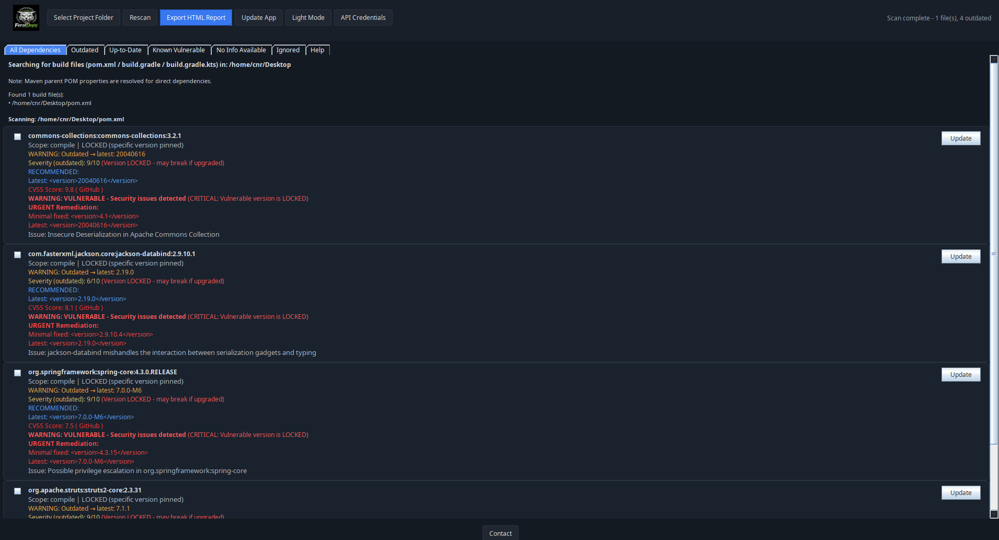
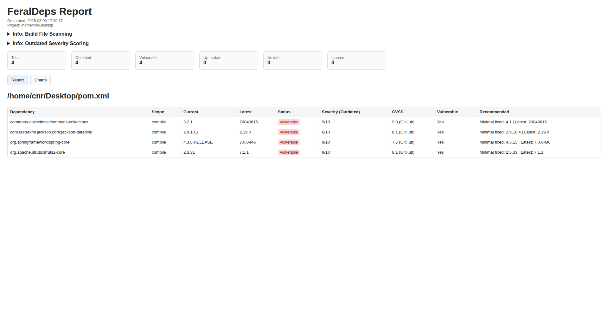
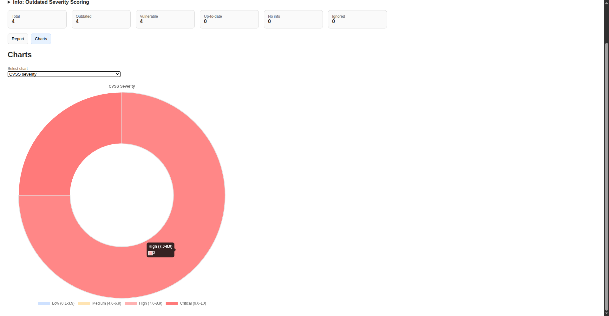
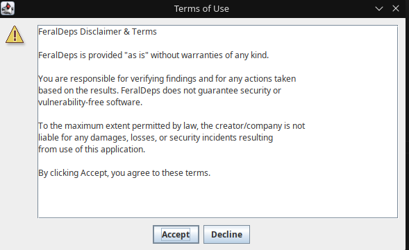

# feraldeps-core

> [!CAUTION]
> **Archived prototype implementation**
>
> This repository contains the original prototype of FeralDeps and is preserved for historical, educational, and development-reference purposes.
>
> **It should not be considered production-ready security software and should not be used to scan untrusted projects.**
>
> The legacy Maven parser uses XML parsing that was not sufficiently hardened against hostile XML input. Other parts of the prototype also rely on simplified, hand-written parsing and error-handling approaches that would need to be redesigned before the project could be considered trustworthy as a security tool.
>
> Development of this implementation has stopped. Any future version of FeralDeps should be treated as a clean redesign rather than a continuation of this codebase.

---

## About

FeralDeps was an experimental local-first dependency and vulnerability scanner for Java and JavaScript projects.

The project explored how a desktop application could inspect declared project dependencies, check whether newer versions were available, query public vulnerability databases, aggregate severity information from multiple sources, and generate local reports.

The prototype supports:

- Maven projects
- Gradle / Gradle Kotlin DSL projects
- npm projects
- Vulnerability lookups using OSV
- Additional CVSS lookups from external services
- HTML report generation
- A desktop GUI
- A command-line interface

The project is maintained as an archived prototype by [@Conor-20105865](https://github.com/Conor-20105865) under [PardixLabs](https://github.com/PardixLabs).

---

## Project Status

**Status: Archived / Legacy Prototype**

FeralDeps `0.1.x` should be considered a proof of concept rather than a finished security product.

The project successfully demonstrated the general workflow of:

```text
Project files
    ↓
Dependency discovery
    ↓
Version lookup
    ↓
Vulnerability lookup
    ↓
Severity / remediation information
    ↓
Local report
```

However, development of the prototype also exposed architectural and security limitations that would require a substantial redesign.

Known areas that would need to be addressed in a future implementation include:

- hardened XML parsing for Maven projects
- structured JSON parsing instead of manual string parsing
- more robust Gradle dependency discovery
- explicit `VULNERABLE`, `CLEAN`, and `UNKNOWN` scan states
- safer handling of failed vulnerability lookups
- proper ecosystem-specific version parsing and comparison
- stronger update verification
- improved separation between scanning logic, API clients, reporting, CLI, and GUI code
- comprehensive automated testing
- stronger hostile-input assumptions throughout the scanner

Because dependency scanners routinely process repositories that may not be trusted, any future implementation should treat all project files and dependency metadata as potentially hostile input.

---

## Security Notice

### Do not scan untrusted repositories with this version

The legacy Maven parser uses Java's XML parser without the full defensive configuration that should be used when processing untrusted XML.

As a result, this implementation should **not** be used to scan arbitrary or untrusted `pom.xml` files.

This is one of the primary reasons the prototype has been archived rather than continued as-is.

Other legacy design decisions include:

- simplified JSON parsing in several API integrations
- regex-based Gradle parsing
- limited validation of data received from dependency files and remote APIs
- an update mechanism that does not implement cryptographic release-signature verification

These are acceptable areas of experimentation in a prototype, but not standards that should be carried into a production security tool.

Please do not rely on FeralDeps `0.1.x` to make security-critical decisions.

---

## Local-first design

Most project inspection and report generation happens locally.

FeralDeps does **not**, however, operate entirely offline.

To determine newer package versions, known vulnerabilities, remediation information, and CVSS data, the application sends dependency identifiers and versions to external services.

Depending on the scan and available configuration, these services may include:

- Maven Central
- npm Registry
- OSV
- Sonatype OSS Index
- NVD
- GitHub APIs

This means FeralDeps should be described as **local-first**, not fully local or offline.

---

## Historical Release

The final prototype release is:

**v0.1.2**

A historical prebuilt JAR is available from the repository's GitHub Releases page.

> [!WARNING]
> The historical binary is provided for reference and experimentation only.
>
> It is **not recommended for scanning untrusted projects or for use as a production vulnerability scanner**.

If running the prototype for educational purposes:

```bash
java -jar feraldeps-0.1.2.jar
```

---

## Features implemented in the prototype

- Scans declared Maven dependencies from `pom.xml`
- Resolves some Maven property-based versions and local parent-POM properties
- Scans common Gradle and Gradle Kotlin dependency declaration formats
- Scans npm `dependencies` and `devDependencies`
- Checks Maven Central and npm for newer versions
- Queries OSV for known vulnerabilities
- Attempts CVSS lookup using multiple external sources
- Provides remediation information where available
- Supports ignored dependencies
- Generates HTML reports
- Provides a desktop GUI
- Provides a command-line interface
- Includes manual update-check functionality

### Important limitations

The scanner primarily focuses on **directly declared dependencies**.

It does not provide complete dependency-resolution semantics equivalent to Maven, Gradle, or npm themselves.

In particular:

- transitive dependency analysis is incomplete
- Gradle parsing only supports a subset of dependency declaration styles
- version catalogs are not fully supported
- dynamically constructed Gradle dependencies may not be detected
- npm lockfiles are not used for full dependency-tree resolution
- Maven model resolution is simplified
- dependency version comparison is not fully ecosystem-aware
- remote API failures can lead to incomplete scan results

---

## Architecture notes

The prototype contains the following major components:

```text
Dependency.java
    Dependency representation and version-related logic

PomParser.java
    Maven POM dependency discovery

GradleParser.java
    Regex-based Gradle dependency discovery

NpmParser.java
    package.json dependency discovery

VulnerabilityDatabase.java
    External version, vulnerability, remediation, and CVSS lookups

ScanResult.java
    Scan result representation

HtmlReportGenerator.java
    HTML report generation

Main.java
    Command-line entry point

GuiMain.java
    Desktop GUI

UpdateManager.java
    GitHub release lookup and legacy update functionality
```

A future implementation should separate these responsibilities more aggressively into independent modules and typed interfaces.

---

## Building from source

### Requirements

- **Java 17 or newer**
- Maven

The project is currently configured to compile against Java 17.

Build from the repository root:

```bash
mvn clean package
```

After a successful build:

```bash
java -jar target/feraldeps-0.1.2.jar
```

The exact output filename may vary if the project version changes.

---

## Command-line usage

The prototype also supports CLI scanning:

```bash
java -jar feraldeps-0.1.2.jar path/to/pom.xml
```

Supported build-file types include:

```text
pom.xml
build.gradle
build.gradle.kts
package.json
```

To generate an HTML report:

```bash
java -jar feraldeps-0.1.2.jar path/to/pom.xml --html report.html
```

A CVSS debug option also exists:

```bash
java -jar feraldeps-0.1.2.jar path/to/pom.xml --cvss-debug
```

---

## External services

The prototype may contact the following services during a scan.

### Maven Central

`search.maven.org`

Used to look up newer versions of Maven dependencies.

### npm Registry

`registry.npmjs.org`

Used to look up npm package metadata and latest versions.

### OSV

`api.osv.dev`

Used as the primary vulnerability-query source.

Dependency package names, ecosystems, and versions may be sent to OSV as part of vulnerability queries.

### Sonatype OSS Index

`ossindex.sonatype.org`

Used as an optional CVSS source.

Authentication credentials may be configured locally.

### National Vulnerability Database

`services.nvd.nist.gov`

Used as an additional CVSS / vulnerability-information source.

### GitHub

`api.github.com`

Used by parts of the prototype for vulnerability/CVSS lookups and release-update checks.

---

## Privacy

FeralDeps performs project-file parsing and report generation locally, but dependency scanning is **not completely private or offline**.

During normal use, dependency identifiers and versions may be transmitted to third-party APIs in order to perform:

- latest-version lookups
- vulnerability searches
- remediation lookups
- CVSS lookups

The prototype does not intentionally upload source-code files to these APIs.

However, users should understand that dependency metadata itself can reveal information about a project's technology stack.

Optional API credentials are stored locally using Java's preferences mechanism and are used when authenticating to their respective services.

Because this is an archived prototype, no guarantees are made regarding the security characteristics of credential storage.

Do not use sensitive production credentials with this version.

---

## Offline operation

There is no complete offline mode in the archived prototype.

Without external network access, local project parsing may still work, but version, vulnerability, remediation, and severity information will generally be incomplete or unavailable.

A future implementation should support an explicit offline mode with clearly defined cached-data behavior.

---

## What a future FeralDeps should change

If this project is rebuilt, the new implementation should begin with a stricter security model.

### Parsing

- disable external entities and DTD resolution in XML parsers
- use a real JSON library
- enforce maximum file sizes and parser limits
- avoid executing arbitrary project build scripts during ordinary scans
- canonicalize and constrain filesystem access

### Dependency representation

Use normalized package identities such as Package URLs where appropriate:

```text
pkg:maven/org.apache.logging.log4j/log4j-core@2.14.1
pkg:npm/lodash@4.17.20
```

### Scan results

Do not represent advisory status as a simple boolean.

Prefer explicit states such as:

```text
VULNERABLE
NOT_VULNERABLE
UNKNOWN
```

A failed API request must not be interpreted as evidence that a package is safe.

### API integrations

Use typed clients and structured response models for:

- OSV
- NVD
- OSS Index
- GitHub
- Maven Central
- npm

### Version handling

Version comparison should be implemented according to ecosystem semantics rather than generic string comparisons.

### Updates

Any future automatic updater should verify release integrity before execution, ideally using signed release metadata or another cryptographically verifiable mechanism.

### Testing

Security-sensitive parsers should include automated tests for malformed and hostile inputs, including:

- malicious XML
- external entities
- recursive entities
- malformed JSON
- unusually large files
- parent-POM cycles
- unusual dependency coordinates
- API failures
- malformed remote responses

---

## Screenshots

The screenshots below show the archived prototype interface and report output.



*Main application window.*



*Generated dependency report.*



*Prototype vulnerability-severity visualization.*



*Initial launch / terms dialog.*

---

## Repository preservation

This repository is retained because the prototype represents useful engineering work and documents the early design of FeralDeps.

It should also serve as a record of lessons learned while developing security tooling, particularly around:

- parsing hostile input
- dependency-resolution complexity
- vulnerability-data reliability
- failure-state handling
- software update trust
- separation of application concerns

The existence of security or architectural shortcomings in this prototype is not being hidden. They are part of the reason the implementation has been archived rather than presented as a finished security product.

---

## Contributing

This repository is archived as a legacy implementation and is not currently under active feature development.

For historical contribution information, see [CONTRIBUTING.md](CONTRIBUTING.md).

---

## Code of Conduct

See [CODE_OF_CONDUCT.md](CODE_OF_CONDUCT.md).

---

## License

See [LICENSE](LICENSE).
